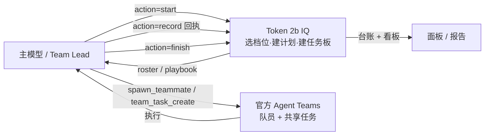

<div align="center">

# Token 2b IQ

### 用可度量的 token 增量，换一次通过率

**DSH（DeepSeek Harness）的多代理编排控制器**：定档位、派团队、收回执、记账本、看面板——
真正干活的仍然是官方 Agent Teams；插件只做「**项目经理 + 记账本 + 仪表盘**」。

[](https://github.com/SSRYLJRSS/dsh-token2biq)
[](LICENSE)
[](https://github.com/deepseek-ai/deepseek-harness)
[](https://awesome-dsh-plugin.com)
[](https://github.com/topics/dsh-plugin)

**简体中文** · [English](README.en.md)

[安装](#安装) · [快速开始](#快速开始) · [核心概念](#核心概念) · [配置项](#配置项哪些硬生效哪些只是建议) · [设计边界](#设计边界与诚实的限制) · [FAQ](#faq)

</div>

---

## 它解决什么问题

DSH 的 Agent Teams 已经解决了「**能不能多代理协作**」——`spawn_teammate` 建队员、`team_task_create` 建共享任务、`send_message` 派活、`wait_agent` 等结果。但从真实工作里看，多代理往往卡在另外三件事上：

| 没有编排层时 | Token 2b IQ 提供 |
| --- | --- |
| 不知道**该开几个代理、分几个阶段、审几轮**，全凭手感 | 用 **S1–S4 / Auto 档位**把「参与角色与阶段数量」变成粗粒度旋钮 |
| 做的人和判的人是同一个，**自己批自己** | 阶段化流水线 + **独立盲审 / 跨厂商评审**（可硬校验） |
| 花了多少 token、走到哪一步、为什么失败，**说不清** | 每阶段 **回执 + token 台账 + 运行看板**，可导出 Markdown 报告 |
| 复杂任务容易「一把梭」直接交付，**没有验证闸门** | 可选 `pipelineGate=strict`：无验收标准不进实现、无 `testsRun` 不许收尾 |

一句话：**它不提升模型本身的能力，它把「多代理该有的流程纪律」变成可配置、可记账、可复盘的东西。**

> ⚠️ **诚实前置**：在 3 个自包含任务的小规模 A/B 里，严格流水线**没有**提升正确率（本来就 100%），只是增加了评审开销、0 返工。所以默认 `pipelineGate=off`——**小任务别开 strict**，价值只可能在「生成者会犯错」的硬任务上体现。详见 [设计边界](#设计边界与诚实的限制)。

---

## 30 秒理解：大脑 vs 手脚

Token 2b IQ **不是**另一套 agent 运行时。它和官方 Agent Teams 是分层协作关系：

| | 官方 Agent Teams | Token 2b IQ |
| --- | --- | --- |
| 角色 | **手脚**：怎么真实地并行 / 分工 / 通信 | **大脑**：干多少、谁评审、花多少、达没达标 |
| 提供 | 建队员、共享任务 DAG、消息、等待 | 档位计划、团队执行手册、回执校验、token 台账、面板 |
| 关系 | 执行原语 | 策略层 + 账本，从不自建运行时 |



---

## 安装

### 方式一：Desktop 插件市场（推荐）

在 **DeepSeek Harness Desktop → 设置 → 插件** 里搜索 `dsh-token2biq`，一键安装。装完**完整重启** DSH。

### 方式二：`dsh plugin` 命令行

```sh
# 直接从 GitHub 源码安装（无需构建，本仓库即插件本身）
dsh plugin --profile web add github:SSRYLJRSS/dsh-token2biq

# 发布到 npm 后也可：dsh plugin --profile web add dsh-token2biq
```

> 把 `web` 换成你实际使用的 profile 名（如 `desktop`）。

### 方式三：本地目录 link（开发者）

```sh
dsh plugin --profile desktop add link:./dsh-token2biq
# 或在 DSH 仓库根用 plugin_manager install_bundle 安装本地包目录
```

### ⚠️ 生效方式（重要）

- **宿主侧 `lib/index.js` / `service.js` / `orchestrator.js` 等只在启动时加载**，改动后**必须完整重启 DSH**（`no-hmr`）。
- 仅改 `lib/client.js`（浏览器面板）可刷新页面即时生效。
- 安装后在侧边栏出现「Token 2b IQ」入口，点击打开面板。

---

## 快速开始

### 1) 选档位：输入框上方的「IQ」下拉

这是**真正的会话级开关**——不是一个装饰性下拉：

`关闭` · `自动` · `轻量(S1)` · `标准(S2)` · `完整(S3)` · `完整加强(S4)`

- 选「关闭」：本会话服务端直接**拒绝** `start`，不会起任何团队。
- 选「轻量 / 标准 / 完整 / 完整加强」：本会话**锁定**该档，模型即便传别的档也会被纠正过来；选择会**落盘**，重启后沿用。
- 选「自动」：关键词先筛，拿不准时用低思考模型复核（失败回退关键词）。

### 2) 让模型调用 `token2biq action=start`

模型在对话里驱动编排。如果调用方是 **Team Lead**，插件会**直接建好共享任务板 + 队员**（返回 `roster / created / modelRouting`），你只需监督执行：

```jsonc
// 模型调用（示意）
{ "action": "start", "goal": "重构鉴权模块，补齐单测", "mode": "S2" }
```

返回里关键字段：

- `plan`：`maxAgents / stages / reviewRounds / costWeight`
- `playbook`：每阶段角色、并行方式、`writeScopes`、团队规则
- `roster`：每个阶段一个常驻队员（`<kind>-<role>`）
- `created`：已完成的任务板与队员（Team Lead 身份下）

### 3) 按 roster 执行 → 每阶段 `record` → 全部完成 `finish`

```text
start ──► spawn/send ──► 队员执行 ──► record（带 teamTaskId / owner / 回执）
                                          │
                                          ▼
                                    阶段推进 + 台账累计
                                          │
                            （评审 FAIL 连续 2 次 → 自动升档）
                                          ▼
                                       finish（verdict）
```

每阶段回执按阶段类型校验：

| 阶段 | 必填回执 |
| --- | --- |
| `generate` 生成 | `files[]` + `diffSummary`（可选 `testsRun[]`） |
| `research` / `plan` 结论 | `summary` 或 `diffSummary`（`files` 可选） |
| `review` / `judge` / `redteam` 裁判 | `verdict`(PASS\|FAIL)，FAIL 必填 `issues[]` |
| `verify` / `regression` 验证 | `verdict`，FAIL 必填 `evidence[]`；strict 下须带非空 `testsRun` |

`record` 还可以带 `tokensIn / tokensOut`（可选，缺省按字符估算）与 `model`（`provider::model`，用于白名单 / 跨厂商硬校验）。

### 其它动作

`map`（只取执行手册）· `state` · `export`（导出 Markdown 报告）· `list` · `mode` · `settings` · `pause` / `resume` · `delete` · `help`

---

## 核心概念

### 4 档位（这是控制 token 消耗的粗粒度手段，不设硬预算）

| 档位 | 参与代理上限 | 阶段流程 | 互审轮数 | 相对成本权重 |
| --- | ---: | --- | ---: | ---: |
| **S1 轻量** | 1 | generate → review → verify | 1 | ×2 |
| **S2 标准** | 3 | plan → generate → review → verify | 3 | ×5 |
| **S3 完整** | 6 | research → plan → generate → review → judge → redteam → regression | 3 | ×10 |
| **S4 完整加强** | 8 | 同 S3，但评审/裁决/红队按角色池**多候选并行多审**（任一 FAIL 即该阶段 FAIL） | 3 | ×16 |
| **Auto 自动** | — | 关键词先筛 → 拿不准用低思考模型复核 → 失败回退关键词 | — | — |

> 早期版本有「token 硬预算熔断」，**已移除**——硬限会直接掐断任务反而导致失败。现在用「档位 = 参与角色数」来粗粒度控制开销。

### 四个零件

| 零件 | 是什么 |
| --- | --- |
| **编排（plan/playbook/roster）** | 把档位翻译成「哪些阶段、每个阶段什么角色、并行还是串行、写域是什么」 |
| **回执（receipt）** | 每阶段的结构化结果，按阶段分派校验（generate 要 files，review 要 verdict…） |
| **账本（ledger）** | 每阶段 token 累计；区分「回执上报/估算」与「宿主实时实测」两个口径 |
| **看板（panel）** | 运行记录 + 概览统计 + 设置，数据来自同源 `/token2biq/*` 路由 |

---

## 面板

> 📸 截图占位：`docs/assets/panel-runs.png`（运行记录）、`docs/assets/panel-overview.png`（概览统计）、`docs/assets/panel-settings.png`（设置）。
> README 只收真实截图，不接受概念图/伪造渲染。

- **运行记录**：每条一眼看到档位、这个档位额外做了什么、结论、token、时间；点开看阶段流程。
- **概览统计（4 卡）**：运行数 / **真实 token（宿主 `llm/stream` 实时实测）** / **回执上报（含估算）** / 一次通过率；下方一行实时明细：输入 / 输出 / 缓存读 / 请求数。
- **两个口径分开**：真实用量与回执上报**不混算**，避免把估算当真实。
- **设置页**：默认档位 / 强制联动 / 按角色指定模型 / 评审模型池 / 必须不同厂商 / 流水线门禁，每项标注**真实生效范围**。

---

## 配置项（哪些硬生效，哪些只是建议）

设置写在 `~/.dsh/token2biq/settings.json`，面板「设置」或 `token2biq action=settings` 修改。**请按「生效范围」列理解每一项**——不要以为标了「建议」的项会被插件拦截。

| 配置 | 作用 | 生效范围 |
| --- | --- | --- |
| `defaultMode` | 新运行/新会话默认档位 | ✅ 硬生效 |
| `forceTeam`（`auto`/`on`/`off`） | 是否要求每阶段都绑定共享任务与队员 | ✅ **硬校验**：开启时 `record` 缺 `teamTaskId`/`owner` 直接拒收。默认 `auto` = S2/S3/S4 强制 |
| `allowModels` | 模型白名单 | ✅ **硬校验**：`record` 上报 `model` 且不在白名单 → 拒收（不上报则不判）。通过 `settings.json` 或 `action=settings` 配置（面板未内置白名单入口） |
| `requireDifferentVendor` | 评审/裁判不得与生成同厂商 | ✅ **硬校验**：`record` 上报同厂商 `model` → 拒收（不上报则不判） |
| `independentReview` | 评审/裁判/红队必须由非执行者盲审 | ✅ **硬校验**：`owner` 不能是本次 generate 执行者（自评拒收） |
| `pipelineGate`（`off`/`strict`） | 严格流水线硬门禁 | ✅ **硬校验**：见下 |
| `rolePools` / `roleModels`（按角色指定模型） | 每阶段用哪个模型 | ⚠️ **建议**：写进执行手册，插件不强制切换 |
| `reviewModels` / `maxReviewers` / `parallelReviews` | 评审池轮转、多审数量 | ⚠️ **建议**：写进手册，由 Lead 用 subagent 落地 |
| 档位 / 阶段流程 | 参与角色与阶段数量 | ⚠️ **强提示**：注入系统提示 + 手册 + `record` 记账约束，但**不是内核级硬拦截**每一步工具调用 |

### `pipelineGate=strict` 到底硬在哪

- **spec 前置**：`record generate` 前必须已有 `spec`（`start` 传 `acceptance`，或先 `record plan/research` 带验收标准），否则拒收。
- **验证证据**：`record verify|regression` 必须带**非空** `testsRun`；`finish` 前必须有完成的 verify/regression 且 `verdict=PASS` 并带非空 `testsRun`，否则不许交付。
- **候选择优**：`start candidates=N`（1..5）开启多候选；每个 `generate` 带 `candidateId`，`judge` 带 `selectedCandidate`，否则拒收。

> 默认 `off`。只在「大改 / 高风险」任务手动开 `strict`，用完改回 `off`。

---

## 设计边界与诚实的限制

这一节是刻意写下来的，避免你带着错误预期安装它：

1. **档位是「强提示 + 记账硬门禁」，不是内核级硬拦截。** 插件通过系统提示、执行手册和 `record` 校验来推动流程；它无法拦截 agent 的每一次工具调用。模型仍可能不按 roster 走，真正的执行一致性依赖官方 Agent Teams 的规范用法。
2. **模型路由阶段必须由 Lead 用 `subagent` 执行。** `spawn_teammate` 只传委派 `provider`，**无法携带 LLM `provider/model`**。所以凡是配置了模型的阶段，playbook 会明确要求 Lead 用 `subagent(provider/model)` 执行，并在 `record` 带回同一个 `model`，否则白名单/跨厂商校验无从生效。
3. **`pipelineGate` 默认 `off`，这是有 A/B 依据的。** 3 个自包含任务（小/中/大）× 2 臂，两臂均 3/3 通过、独立盲审 3/3 PASS、0 返工——严格流水线在小任务上**不提升正确率、只增加开销**。其价值待「生成者会犯错」的硬任务再验证。
4. **「真实 token」是全进程口径，不是按队员精确归属。** 宿主 `llm/stream` 的 usage 分片不带 `runId`，插件只能把运行活跃期间**同进程**的调用都归到当前运行；同期的其他对话也可能被算进来。数值偏高于预期时，通常就是这个原因。
5. **generate 默认串行（共享 cwd、无文件锁）。** 确需并行时，各任务 `writeScopes` 必须互不重叠；并行队员数按执行手册上限（默认 8）。
6. **`independentReview` 是 owner 校验，不是「插件自己跑一个指定模型的评委」。** 宿主没有同步「跑完并返回 verdict」的接口，插件不会自造 agent 运行时；如需异源评委，由 Lead 起独立子代理执行后回执。
7. **真实端到端仍需重启验证。** 宿主 JS 只在启动时装载；install 返回 `restart-required`。
8. **HTTP 仅监听本机 `127.0.0.1`，未加 CSRF/Origin 校验**（风险有限，未改）。`readJson` 有 1MB body 上限。

---

## FAQ

**Q：它会替代官方 Agent Teams 吗？**
不会。它是策略层与账本，执行原语仍全部来自官方 Agent Teams（`spawn_teammate` / `team_task_*` / `send_message` / `wait_agent`）。两者是「经理」与「施工队」。

**Q：为什么装上之后面板是空的？**
面板只显示**真正调用过 `token2biq action=start`** 的运行。没有运行就不会有记录——这不是 bug。

**Q：小任务要不要用它？**
不必。小任务在「自动」档下不会起团队；强制组队只会白烧 token。选「关闭」或让模型对小任务直接做。

**Q：为什么改了设置没生效 / 为什么要重启？**
宿主侧代码（`lib/*.js` 除 `client.js`）只在启动时加载。改动后必须完整重启 DSH；仅面板代码可刷新页生效。

**Q：token 数字为什么和我预期的不一样？**
看板有**两个口径**：`N tok` = 宿主实时实测（全进程归集，可能偏高）；`≈N tok（估算）` = 回执上报或字符估算（仅参考）。两者不混算。

**Q：评审为什么老是被拒收？**
多半是 `forceTeam`（S2/S3/S4 默认强制）要求 `record` 带 `teamTaskId`+`owner`，或 `requireDifferentVendor` 发现评审与生成同厂商。按提示补字段或调设置即可。

---

## 开发与测试

```sh
cd dsh-token2biq

# 语法检查
node --check lib/index.js lib/service.js lib/orchestrator.js lib/receipts.js lib/run-store.js lib/report.js lib/settings.js lib/paths.js lib/model-routes.js

# 纯逻辑单测 + 服务集成测试（内存 store，不依赖宿主）
node --test
```

当前状态（本机 Node 24、2026-11-13 实测）：

- `node --test` → **131 / 131 通过**（逻辑 + 服务集成；冒烟脚本为独立 `*.mjs`）
- `npm pack --dry-run` → 发布包包含 `lib/` 下全部模块（含 `model-routes.js`）

目录速览：

```
lib/
├── index.js        宿主入口：web 路由 + token2biq 工具
├── service.js      核心服务：档位/计划/回执/台账/看板/分发
├── orchestrator.js 纯函数：档位 PLANS / classify / playbook / roster
├── receipts.js     纯函数：按阶段校验回执
├── run-store.js    8 实体持久化（JSON 原子写；可纯内存）
├── report.js       纯函数：导出 Markdown 报告
├── settings.js     设置存储与规整
├── model-routes.js 子代理模型放行策略
├── paths.js        状态文件路径
└── client.js       浏览器面板
```

---

## License

MIT · 见 [LICENSE](LICENSE)
