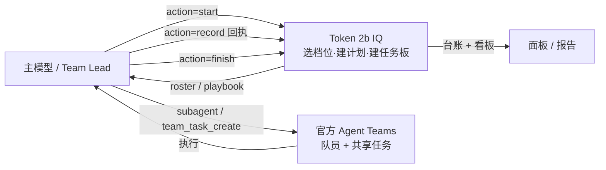

<div align="center">

# Token 2b IQ

### 用可度量的 token 增量，换一次通过率

**DSH（DeepSeek Harness）的多代理编排控制器**：定档位、派团队、收回执、记账本、看面板——
真正干活的仍然是官方 Agent Teams；插件只做「**项目经理 + 记账本 + 仪表盘**」。

[](https://github.com/SSRYLJRSS/dsh-token2biq)
[](https://github.com/SSRYLJRSS/dsh-token2biq/actions/workflows/ci.yml)
[](https://github.com/SSRYLJRSS/dsh-token2biq/releases)
[](https://github.com/SSRYLJRSS/dsh-token2biq/releases)
[](LICENSE)
[](https://github.com/deepseek-ai/deepseek-harness)
[](https://awesome-dsh-plugin.com)
[](https://github.com/topics/dsh-plugin)

**简体中文** · [English](README.en.md)

[安装](#安装) · [快速开始](#快速开始) · [核心概念](#核心概念) · [配置项](#配置项哪些硬生效哪些只是建议) · [设计边界](#设计边界与诚实的限制) · [文档与发布入口](#文档与发布入口) · [FAQ](#faq)

</div>

---

## 它解决什么问题

DSH 的 Agent Teams 已经解决了「**能不能多代理协作**」——`subagent` 建队员、`team_task_create` 建共享任务、`send_message` 派活、`wait_agent` 等结果。但从真实工作里看，多代理往往卡在另外三件事上：

| 没有编排层时 | Token 2b IQ 提供 |
| --- | --- |
| 不知道**该开几个代理、分几个阶段、审几轮**，全凭手感 | 用 **S1–S4 / Auto 档位**把「参与角色与阶段数量」变成粗粒度旋钮 |
| 做的人和判的人是同一个，**自己批自己** | 阶段化流水线 + **独立盲审**（可硬校验） |
| 花了多少 token、走到哪一步、为什么失败，**说不清** | 每阶段 **回执 + token 台账 + 运行看板**，可导出 Markdown 报告 |
| 复杂任务容易「一把梭」直接交付，**没有验证闸门** | 可选 `pipelineGate=strict`：无验收标准不进实现、无 `testsRun` 不许收尾 |

一句话：**它不提升模型本身的能力，它把「多代理该有的流程纪律」变成可配置、可记账、可复盘的东西。**

> ⚠️ **诚实前置**：在 3 个自包含任务的小规模 A/B 里，严格流水线**没有**提升正确率（本来就 100%），只是增加了评审开销、0 返工。所以默认 `pipelineGate=off`——**小任务别开 strict**，价值只可能在「生成者会犯错」的硬任务上体现。详见 [设计边界](#设计边界与诚实的限制)。

---

## 30 秒理解：大脑 vs 手脚

Token 2b IQ **不是**另一套 agent 运行时。它和官方 Agent Teams 是分层协作关系：

| | 官方 Agent Teams | Token 2b IQ |
| --- | --- | --- |
| 角色 | **手脚**：怎么真实地并行 / 分工 / 通信 | **大脑**：干多少、谁评审、花多少、达没达标 |
| 提供 | 建队员、共享任务 DAG、消息、等待 | 档位计划、团队执行手册、回执校验、token 台账、面板 |
| 关系 | 执行原语 | 策略层 + 账本，从不自建运行时 |



---

## v0.9 更新：更聪明，也更谨慎

这一版把「怎么编排」从「按档位死配」升级为「先读懂任务，再谨慎决定」：

- **AI 任务画像（P0）**：开跑前先让模型判断任务类型（写代码 / 查资料）、复杂度、风险，再选流水线；不再只靠关键词，把「看代码」误判成「写代码」的老问题基本消除。
- **按复杂度配平（P0/P2）**：在所选档位上限内，只对**确实简单**的任务做「减法」，去掉冗余阶段；**中等 / 复杂 / 高风险一律按你选的档位完整跑**。
- **谨慎降档（本版核心）**：降档只发生在「简单」任务，且**降档不降验收**——代码保留「评审 + 测试」，调查 / 文档保留「引用 / 事实核验」（防幻觉）。每次降档都会在 `start` 返回的 `rigor` 里写清原因；要绝对严谨可传 `strictRigor:true` 强制满档。
- **按类型证据（P1）**：`strict` 门禁下，调查类用「引用核对」、代码类用「真实测试」作验收证据，不再互相为难、不再逼着造假。
- **分类缓存 + 提示词压缩（P1/P2）**：同一目标不重复调用画像模型；队员提示词更短（实测约 −5%），省 token 而不降质。

| 任务情形 | 会怎么跑 |
| --- | --- |
| 你选高档 + 中等 / 复杂 / 高风险 | 按你选的整档完整跑，一步不砍 |
| 你选高档 + 确实简单（查资料 / 核真假） | 谨慎降一档，但保留「核验 / 评审」 |
| 拿不准 | 宁可按高标准来，不乱降 |

> 一句话：**你说得越大，它越不敢乱砍；只有小到查资料、核真假，才降一点，且一定留着「核验」这关。**

## 安装

### 方式一：Desktop 插件市场（推荐）

在 **DeepSeek Harness Desktop → 设置 → 插件** 里搜索 `dsh-token2biq`，一键安装。装完**完整退出并重启** DSH。

> 市场按注册表的 GitHub 源安装。本包零运行时依赖、没有 build 脚本；插件加载时会自动补好 Agent Teams 与子代理模型选择两项宿主配置。

### 方式二：`dsh plugin` 命令行（GitHub 源，推荐）

```sh
dsh plugin --profile desktop add github:SSRYLJRSS/dsh-token2biq
```

> 这是与插件市场相同的安装源。把 `desktop` 换成实际 profile 名（如 `web`）。若网络只能直连 GitHub Release，可改用方式三的预构建 tarball。
>
> 若报 `UNABLE_TO_VERIFY_LEAF_SIGNATURE`，先在 PowerShell 执行 `$env:NODE_OPTIONS='--use-system-ca'` 再重试；这是本机 Node 不信任 GitHub 证书链，不是插件问题。

### 方式三：预构建 tarball（可选）

```sh
# 最新版（推荐；与市场同源，每次发版自动指向最新）
dsh plugin --profile desktop add https://github.com/SSRYLJRSS/dsh-token2biq/releases/latest/download/dsh-token2biq.tgz
# 需要固定版本可用 GitHub 源：dsh plugin --profile desktop add github:SSRYLJRSS/dsh-token2biq#v0.9.1
```

> 包内零依赖、无安装脚本，不需要 `allowBuilds`。若报 `UNABLE_TO_VERIFY_LEAF_SIGNATURE`，说明本机 Node 不信任 GitHub Release 的证书链：改用方式二，或在启动 DSH 前设置 `NODE_OPTIONS=--use-system-ca`。

### 方式四：本地源码 link（仅开发/排障）

```sh
git clone https://github.com/SSRYLJRSS/dsh-token2biq.git
dsh plugin --profile desktop add link:/absolute/path/to/dsh-token2biq
```

> `link:` 会在 profile 的 `node_modules/dsh-token2biq` 建目录联接（junction）。**切回市场/云端安装前必须先删掉它**，否则 pnpm 会在 import 阶段报 `ERR_PNPM_EPERM ... rename ... dsh-token2biq_tmp_... -> dsh-token2biq`，安装会一直卡住。

Windows 删除残留联接（只删链接，不删源码）：

```powershell
$p = "$env:USERPROFILE\.dsh\profiles\desktop\node_modules\dsh-token2biq"
if (Test-Path $p) { (Get-Item $p -Force).Delete() }
```

macOS / Linux：

```sh
rm -f ~/.dsh/profiles/desktop/node_modules/dsh-token2biq
```

### 版本与兼容性

- 包版本：`0.9.1`
- DSH 兼容范围：`>=0.2.2-rc.3 <0.3.0-0`，同时写在 `package.json` 的 `engines.dsh` 与 `dsh.compatibility.dsh`
- 市场与宿主读取 `engines.dsh` 判定兼容；不会再显示“无版本声明 / 兼容未知”

### ⚠️ 生效方式（重要）

- **宿主侧 `lib/index.js` / `service.js` / `orchestrator.js` 等只在启动时加载**，改动后**必须完整重启 DSH**（`no-hmr`）。
- 浏览器代码需要宿主重新构建客户端产物后刷新；只有同一 checkout 的 `pnpm run dev:web` 监听器运行时才支持开发热更新。不能只凭源文件已保存判断当前界面已更新。
- 安装后在侧边栏出现「Token 2b IQ」入口，点击打开面板。

---

## 快速开始

### 1) 选档位：输入框上方的「IQ」下拉

这是**真正的会话级开关**——不是一个装饰性下拉：

`关闭` · `自动` · `轻量 S1` · `标准 S2` · `完整 S3` · `完整加强 S4`（界面与文档统一显示 S 代号，和 `action=start` 的 `mode` 对得上）

- 选「关闭」：本会话服务端直接**拒绝** `start`，不会起任何团队。
- 选「轻量 / 标准 / 完整 / 完整加强」：本会话**锁定**该档，模型即便传别的档也会被纠正过来；选择会**落盘**，重启后沿用。
- 选「自动」：关键词先筛，拿不准时用低思考模型复核（失败回退关键词）。

### 2) 让模型调用 `token2biq action=start`

模型在对话里驱动编排。如果调用方是 **Team Lead**，插件创建官方共享任务板，并返回 `roster / created.briefing / modelRouting`。Lead 仍需调用官方 `subagent` 启动队员，再用 `send_message` 派活；任务变为 ready 不会自动启动队员。

```jsonc
// 模型调用（示意）
{ "action": "start", "goal": "重构鉴权模块，补齐单测", "mode": "S2" }
```

返回里关键字段：

- `plan`：`maxAgents / stages / reviewRounds / costWeight`
- `playbook`：每阶段角色、并行方式、`writeScopes`、团队规则
- `roster`：阶段角色与建议队员名，不代表队员已经启动
- `created`：已创建的共享任务、派活说明及模型路由；失败或降级情况单独返回

### 3) 按 roster 执行 → 每阶段 `record` → 全部完成 `finish`

```text
start ──► spawn/send ──► 队员执行 ──► record（带 teamTaskId / owner / 回执）
                                          │
                                          ▼
                                    阶段推进 + 台账累计
                                          │
                            （评审 FAIL 连续 2 次 → 自动升档）
                                          ▼
                                       finish（verdict）
```

每阶段回执按阶段类型校验：

| 阶段 | 必填回执 |
| --- | --- |
| `generate` 生成 | `files[]` + `diffSummary`（可选 `testsRun[]`） |
| `research` / `plan` 结论 | `summary` 或 `diffSummary`（`files` 可选） |
| `review` / `judge` / `redteam` 裁判 | `verdict`(PASS\|FAIL)，FAIL 必填 `issues[]` |
| `verify` / `regression` 验证 | `verdict`，FAIL 必填 `evidence[]`；strict 下 `verdict=PASS` 时须带**已通过**的证据：`testsRun:[{cmd, ok:true}]` 或 `testsRun:["…"]` + `testsPassed:true` |

`record` 还可以带 `tokensIn / tokensOut`（可选，缺省按字符估算）与 `model`（`provider::model`，用于白名单硬校验）。

### 其它动作

`map`（只取执行手册）· `state` · `export`（导出 Markdown 报告）· `list` · `mode` · `settings` · `pause` / `resume` · `delete` · `help`

---

## 核心概念

### 4 档位（这是控制 token 消耗的粗粒度手段，不设硬预算）

| 档位 | 参与代理上限 | 阶段流程 | 相对成本权重 |
| --- | ---: | --- | ---: |
| **S1 轻量** | 1 | generate → verify（2 阶段，1 代理） | ×2 |
| **S2 标准** | 3 | plan → generate → review → verify（4 阶段） | ×5 |
| **S3 完整** | 5 | 核心 5 阶段：research → plan → generate → review → regression；高风险追加 judge / redteam（完整 7 阶段） | ×10 |
| **S4 完整加强** | 8 | 完整 7 阶段：research → plan → generate → review → judge → redteam → regression；评审双路并行（review 由两个独立模型并行盲审，任一 FAIL 即该阶段 FAIL） | ×16 |

> **0.7.0 起：调查/文档类任务走另一套流水线。** `taskType=investigation`（或 `auto` 判定为调查）时，阶段变为 **research → synth → review → verify / regression**——没有 `generate`，改由 `synth`（synthesizer）产出报告/文档（回执同样要 `files` + `diffSummary`）。S1 收缩为 research→synth→verify，S3/S4 追加 judge/redteam。这样「回顾/调查/审计」类任务不必再为了满足代码流水线而伪造实现产物，也不会因为「没有 generate」而永远 `finish` 不了。
| **Auto 自动** | — | 关键词先筛 → 拿不准用低思考模型复核 → 失败回退关键词 | — |

> 0.5.0 起提供**成本闸门**（`settings.tokenBudget`，0=不限）：消耗到 80% 时面板与 `action=state` 提示收敛，到 100% 时熔断——不再新建任务，由 Lead 用现有回执收口。它只拦「新建」，不会掐断已完成的工作。日常仍用「档位 = 参与角色数」做粗粒度控制。

> S3 的 judge / redteam 是**高风险追加阶段**：`start` 传 `risk: "high"`（或 `strict`）才进入；`regression` 属核心阶段，始终执行，普通任务只跑核心 5 阶段。S4 的「评审双路」指同一 `review` 阶段由两个独立模型并行盲审，任一 FAIL 即该阶段 FAIL；其余阶段不并行。

### 思考强度（reasoning effort）

每个阶段真正调用模型时，除了「用哪个模型」，还能决定「想多深」。默认策略是 **auto**：不给具体档，按「档位 × 角色」矩阵自动取。

- **默认 auto 矩阵**（`settings.reasoning.default = "auto"`）。未在角色/模型上覆盖时，按档位与角色查表（`MODE_ROLE_EFFORT`）：

| 档位 | 研究 | 计划 | 生成 | 评审 | 裁决 | 红队 | 验证 | 回归 | 其它(默认) |
| --- | --- | --- | --- | --- | --- | --- | --- | --- | --- |
| S1 | — | — | high | high | — | — | high | — | high |
| S2 | — | high | high | high | — | — | high | — | high |
| S3 | high | high | high | high | xhigh | high | high | high | high |
| S4 | high | xhigh | high | xhigh | xhigh | xhigh | high | high | high |

- **按角色覆盖**：`settings.reasoning.byRole[<角色>]`，取值为 `off / minimal / low / medium / high / xhigh / max`（`auto` 表示不覆盖）。
- **按模型覆盖**：`settings.reasoning.byModel["provider::model"]`，粒度到具体模型。
- **优先级**：按模型 > 按角色 > 全局默认 `auto`（查矩阵）。可在面板「设置 → 思考强度」或 `token2biq action=settings` 的 `reasoning` 字段配置。
- **模型思考强度能力**：解析优先读 `reasoning.supportedEfforts`（旧 `reasoning.efforts` 兜底）与 `reasoning.defaultEffort`。仅 `defaultEffort`、无可选档的旧模型会**省略** `reasoning_effort` 参数、照常调用、不报错（面板显示「仅默认 <档>」）；若首选档不在可选档内，按 `off → minimal → low → medium → high → xhigh → max` 顺序**向下就近降档**，再退回模型默认档。

### 四个零件

| 零件 | 是什么 |
| --- | --- |
| **编排（plan/playbook/roster）** | 把档位翻译成「哪些阶段、每个阶段什么角色、并行还是串行、写域是什么」 |
| **回执（receipt）** | 每阶段的结构化结果，按阶段分派校验（generate 要 files，review 要 verdict…） |
| **账本（ledger）** | 每阶段 token 累计；区分「回执上报/估算」与「宿主实时实测」两个口径 |
| **看板（panel）** | 运行记录 + 概览统计 + 设置，数据来自同源 `/token2biq/*` 路由 |

---

## 面板

界面验证范围与当前限制见 [验证说明](https://github.com/SSRYLJRSS/dsh-token2biq/blob/main/docs/VERIFICATION.md)。

- **运行记录**：每条一眼看到档位、这个档位额外做了什么、结论、token、时间；点开看阶段流程。
- **概览统计（4 卡）**：运行数 / **真实 token（宿主 `llm/stream` 实时实测）** / **回执上报（含估算）** / 一次通过率；下方一行实时明细：输入 / 输出 / 缓存读 / 请求数。
- **两个口径分开**：真实用量与回执上报**不混算**，避免把估算当真实。
- **设置页**：模型 / 思考强度 / 高级三页。模型页可单独指定 8 个角色（多人评审最多 5 个、按顺序取主模型），或全部「跟随主对话」；思考强度页配置全局默认、8 个角色覆盖与按模型覆盖；高级页管理默认档位、强制团队、S4 并行审模型数、严格流程和独立评委。

---

## 配置项（哪些硬生效，哪些只是建议）

设置写在 `~/.dsh/token2biq/settings.json`，面板「设置」或 `token2biq action=settings` 修改。**请按「生效范围」列理解每一项**——不要以为标了「建议」的项会被插件拦截。升级旧配置请看 [设置 V3 升级说明](docs/V3-UPGRADE.md)。

| 配置 | 作用 | 生效范围 |
| --- | --- | --- |
| `defaultMode` | 新运行/新会话默认档位 | ✅ 硬生效 |
| `forceTeam`（`auto`/`on`/`off`） | 是否要求每阶段都绑定共享任务与队员 | ✅ **硬校验**：开启时 `record` 缺 `teamTaskId`/`owner` 直接拒收。默认 `auto` = S2/S3/S4 强制 |
| `allowModels` | 模型白名单 | ✅ **硬校验**：`record` 上报 `model` 且不在白名单 → 拒收（不上报则不判）。通过 `settings.json` 或 `action=settings` 配置（面板未内置白名单入口） |
| `independentReview` | 评审/裁判/红队必须由非执行者盲审 | ✅ **硬校验**：`owner` 不能是本次 generate 执行者（自评拒收） |
| `tokenBudget` | 每运行 token 预算（`0`=不限） | ✅ **硬生效**：≥80% 提示收敛，≥100% 熔断——不再新建任务，由 Lead 用现有回执收口 |
| `pipelineGate`（`off`/`strict`/`auto`） | 严格流水线硬门禁 | ✅ **硬校验**：见下。`auto`=按任务类型+档位自动：调查任务 off；代码任务仅 S3/S4 开 strict |
| `taskType`（`auto`/`code`/`investigation`） | 任务类型，决定用哪套流水线 | ✅ **硬生效**：`start` 时定死并落到运行快照。`investigation` 走 research→synth→review→verify（**无 generate**）；`auto` 按目标文本判定（出现代码动作词一律按 code） |
| `rolePools`（按角色指定模型） | 每阶段用哪个模型；8 个 key 永远存在，空数组=跟随主对话；数组顺序即优先级 | ⚠️ **建议**：写进执行手册，插件不强制切换。`roleModels` 是只读派生字段（池首项），不会落盘 |
| `parallelReviews`（S4 并行审模型数） | 完整加强 S4 的 `review` 阶段并行盲审数（1..5，实际最多 2 路） | ⚠️ **建议**：写进执行手册，由 Lead 用 subagent 落地；实际并行数 = min(该值, 已选模型数, 2) |
| 档位 / 阶段流程 | 参与角色与阶段数量 | ⚠️ **强提示**：注入系统提示 + 手册 + `record` 记账约束，但**不是内核级硬拦截**每一步工具调用 |

### `pipelineGate=strict` 到底硬在哪

- **spec 前置**：`record generate` 前必须已有 `spec`（`start` 传 `acceptance`，或先 `record plan/research` 带验收标准），否则拒收。
- **验证证据**：`record verify|regression` 必须带**非空** `testsRun`；`verdict=PASS` 时还必须是**已通过**的证据——每项 `ok:true`，或配 `testsPassed:true` 显式声明。只写命令名（`ok:null`）会在 `record` 阶段就被拒收并给出两种合法写法（0.7.0 起），不再拖到 `finish` 才报一句看不懂的错。**FAIL 回执不受此限**——它本身就是在报告失败。`finish` 前必须有完成的 verify/regression 且 `verdict=PASS`，否则不许交付。
- **候选择优**：`start candidates=N`（1..5）开启多候选；每个 `generate` 带 `candidateId`，`judge` 带 `selectedCandidate`，否则拒收。

> 默认 `off`。只在「大改 / 高风险」任务手动开 `strict`，用完改回 `off`。

---

## 设计边界与诚实的限制

这一节是刻意写下来的，避免你带着错误预期安装它：

1. **档位是「强提示 + 记账硬门禁」，不是内核级硬拦截。** 插件通过系统提示、执行手册和 `record` 校验来推动流程；它无法拦截 agent 的每一次工具调用。模型仍可能不按 roster 走，真正的执行一致性依赖官方 Agent Teams 的规范用法。
2. **模型路由阶段必须由 Lead 用 `subagent` 执行。** `subagent` 可显式传 `provider/model`（`subagent_fork` 不支持模型选择）。所以凡是配置了模型的阶段，playbook 会明确要求 Lead 用 `subagent(provider/model)` 执行，并在 `record` 带回同一个 `model`，否则白名单校验无从生效。
3. **`pipelineGate` 默认 `off`，这是有 A/B 依据的。** 3 个自包含任务（小/中/大）× 2 臂，两臂均 3/3 通过、独立盲审 3/3 PASS、0 返工——严格流水线在小任务上**不提升正确率、只增加开销**。其价值待「生成者会犯错」的硬任务再验证。
4. **「真实 token」是全进程口径，不是按队员精确归属。** 宿主 `llm/stream` 的 usage 分片不带 `runId`，插件只能把运行活跃期间**同进程**的调用都归到当前运行；同期的其他对话也可能被算进来。数值偏高于预期时，通常就是这个原因。
5. **generate 默认串行（共享 cwd、无文件锁）。** 确需并行时，各任务 `writeScopes` 必须互不重叠；并行队员数按执行手册上限（S4 最多 8 个代理）。
6. **`independentReview` 是 owner 校验，不是「插件自己跑一个指定模型的评委」。** 宿主没有同步「跑完并返回 verdict」的接口，插件不会自造 agent 运行时；如需异源评委，由 Lead 起独立子代理执行后回执。
7. **真实端到端仍需重启验证。** 宿主 JS 只在启动时装载；install 返回 `restart-required`。
8. **HTTP 路由已接官方 `ctx.connection.requestRejection`**（未信任 Host/Origin → 403，未认证 → 401），请求体按 `application/json` 解析，并有 `readJson` 1MB body 上限；访问控制以宿主 `requestRejection` 为准（插件不额外维护 Origin 白名单）。

---

## FAQ

**Q：它会替代官方 Agent Teams 吗？**
不会。它是策略层与账本，执行原语仍全部来自官方 Agent Teams（`subagent` / `team_task_*` / `send_message` / `wait_agent`）。两者是「经理」与「施工队」。

**Q：为什么装上之后面板是空的？**
面板只显示**真正调用过 `token2biq action=start`** 的运行。没有运行就不会有记录——这不是 bug。

**Q：小任务要不要用它？**
不必。小任务在「自动」档下不会起团队；强制组队只会白烧 token。选「关闭」或让模型对小任务直接做。

**Q：为什么改了设置没生效 / 为什么要重启？**
宿主侧代码（`lib/*.js` 除 `client.js`）只在启动时加载。改动后必须完整重启 DSH；仅面板代码可刷新页生效。

**Q：token 数字为什么和我预期的不一样？**
看板有**两个口径**：`N tok` = 宿主实时实测（全进程归集，可能偏高）；`≈N tok（估算）` = 回执上报或字符估算（仅参考）。两者不混算。

**Q：评审为什么老是被拒收？**
多半是 `forceTeam`（S2/S3/S4 默认强制）要求 `record` 带 `teamTaskId`+`owner`。按提示补字段或调设置即可。

---

## 安装与活动 profile 定位

- **市场 TLS**：市场按 GitHub 源安装；若报 `UNABLE_TO_VERIFY_LEAF_SIGNATURE`，是本机 Node 不信任 GitHub 证书链——PowerShell 先 `$env:NODE_OPTIONS='--use-system-ca'` 再安装/启动。
- **junction 清理**：`link:` 安装会在 profile 的 `node_modules/dsh-token2biq` 建目录联接；切回市场/云端安装前必须先删，否则 pnpm 报 `ERR_PNPM_EPERM ... rename` 卡住。
- **活动 profile 定位（优先级）**：显式参数 `profile` → 设置 `provisionProfile` → 环境变量 `DSH_PROFILE` → 插件安装路径 `profiles/<name>/node_modules` 反解 → 枚举 `~/.dsh/profiles/*`（仅唯一命中）。多 profile 且无可靠来源时**不写文件**，`action=provision` 返回 `ok:false` 与 `candidates` 候选列表，绝不静默写 `desktop`。
- **`provisionStatus`**：最近一次自动配置结果（`ok/changed/patchFile/profileTargeted/candidates/error`）在 `action=state` 可见；启动失败会 `console.warn` 并记录在此，不阻断 DSH 启动。
- **`action=provision`**：手动重跑（幂等），返回 `profileTargeted / patchFile / candidates / added / merged / unchanged / skipped`。

## 安装后自动配置（免手动勾选）

插件加载时会自动改好两处 DSH 宿主设置。首次加载会写入 profile；**重启 DSH** 后生效（若宿主没有热重载，需再重启一次）：

> 已在 DSH 0.2.2-rc.3 + Desktop profile 实测：两条都会写入；若已有同 id 条目则保持原样，不覆盖用户配置。

| 自动写入 | 位置 | 效果 |
| --- | --- | --- |
| `- id: agent-team` → `defaultEnabled: true` | `~/.dsh/profiles/<profile>/cordis.patch.yml` | 新根会话默认启用官方 Agent Teams（已有选择优先，不覆盖历史会话） |
| `- id: subagent-model-selection-settings` → `enabled: true` + 自动勾选当前模型 | 同上 | 子代理可以选不同模型，可用模型已按 `settings.yaml` 自动列好 |

安全边界（按“别把 DSH 弄坏”设计）：

- **绝不改 `~/.dsh/settings.yaml`**（密钥、供应商、模型定义保持原样）。
- 只**追加**上述两个条目；同 id 已有用户自定义配置时**跳过不覆盖**，并在结果里提示。
- 模型列表为空时**只写团队条目**，不写空 `allowedModels`（官方要求至少一个模型）。
- 写前备份为 `cordis.patch.yml.bak-token2biq-<时间戳>`，临时文件 + 原子替换，写后校验，失败自动回滚。
- 幂等：内容已符合要求时零改动，重复启动不会叠加。

关闭 / 重跑 / 回滚：

- 关闭：设置 `autoProvision: false`（或删除上面两个条目，或用备份覆盖回 `cordis.patch.yml`）。
- 手动重跑：`token2biq action=provision`（可带 `home`/`profile`）。
- 回滚：把 `cordis.patch.yml.bak-token2biq-*` 复制回 `cordis.patch.yml` 后重启。

---

## 文档与发布入口

| 文档 | 内容 |
| --- | --- |
| [CHANGELOG.md](CHANGELOG.md) | 版本变更记录（当前 **0.9.1**） |
| [安装与升级指南](docs/INSTALL.md) | 市场/CLI/源码安装、junction 清理、版本声明与回滚 |
| [0.6 优化说明](docs/OPTIMIZATION-0.6.md) | 0.6.0 的档位重排、思考强度与提示词瘦身 |
| [架构说明](docs/ARCHITECTURE.md) | 执行模型、模块职责与维护边界 |
| [验证指南](docs/VERIFICATION.md) | 测试入口、验证范围与实测结果 |
| [审查台账](docs/AUDIT-2026-11-16.md) | 本轮审查与修复验收记录 |
| [GitHub Releases](https://github.com/SSRYLJRSS/dsh-token2biq/releases) | 发布说明与版本分发（`v0.9.1`） |

---

## 开发与测试

```sh
cd dsh-token2biq

# 逐文件语法检查
npm run check

# 自动隔离用户状态的逻辑、服务和宿主契约测试
npm test

# 检查发布包内容
npm pack --dry-run
```

测试结果和执行环境见 [验证说明](https://github.com/SSRYLJRSS/dsh-token2biq/blob/main/docs/VERIFICATION.md)；代码结构见 [架构说明](https://github.com/SSRYLJRSS/dsh-token2biq/blob/main/docs/ARCHITECTURE.md)，本轮审查见 [审查报告](https://github.com/SSRYLJRSS/dsh-token2biq/blob/main/docs/AUDIT-2026-11-16.md)。请使用 `npm test` 的隔离入口，避免手工执行历史冒烟脚本写入真实用户配置。

目录速览：

```
lib/
├── index.js        宿主入口：web 路由 + token2biq 工具
├── host-integration.js 官方 Agent Teams 适配：解析活跃根会话，仅调 isEnabled/setEnabled/rootOf，失败返真实原因
├── autoprovision.js 安装后自动配置：追加 agent-team.defaultEnabled 与子代理模型白名单（备份/原子写/校验/回滚，幂等）
├── service.js      核心服务：档位/计划/回执/台账/看板/分发
├── orchestrator.js 纯函数：档位 PLANS / classify / playbook / roster
├── receipts.js     纯函数：按阶段校验回执
├── stage-state.js  纯函数：按 slot 聚合阶段状态，teamTaskId 优先、owner 次之，任一 FAIL 即 FAIL，重试自愈
├── run-store.js    8 实体持久化（JSON 原子写；可纯内存）
├── report.js       纯函数：导出 Markdown 报告
├── settings.js     设置存储与规整
├── model-routes.js 子代理模型放行策略
├── paths.js        状态文件路径
└── client.js       浏览器面板
```

---

## 发版约定（保证市场自动更新）

- 每个 Release **只上传一个** tarball，文件名固定为 `dsh-token2biq.tgz`（**不带版本号**）。
- 市场条目与 `releases/latest/download/dsh-token2biq.tgz` 都依赖这个固定资产名：每次发版市场自动跟到最新，无需再改目录。
- 版本号写进 `package.json` / git tag；需要钉版本的用户用 `github:SSRYLJRSS/dsh-token2biq#vX.Y.Z`。

## License

MIT · 见 [LICENSE](LICENSE)
